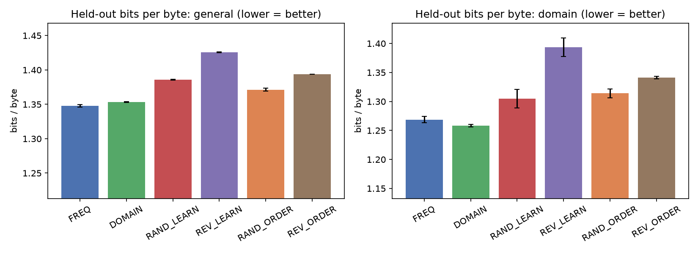
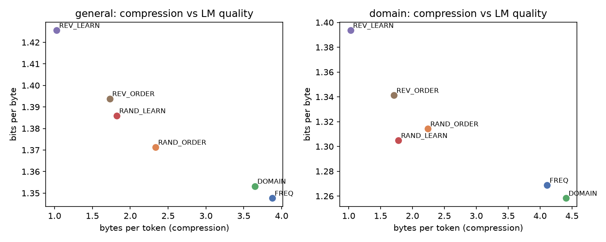
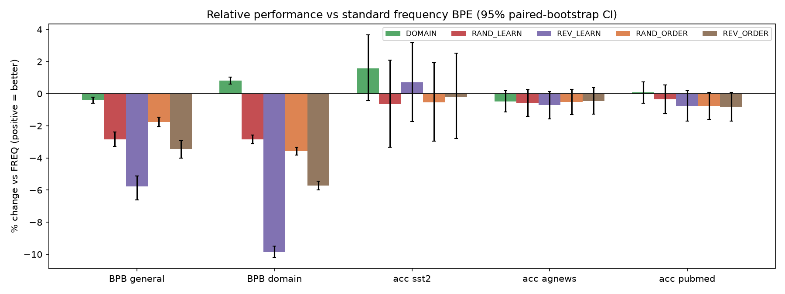

# Tokenizer Merge-Order Sensitivity: How BPE Merge Sequence Affects Downstream Performance

## 1. Executive Summary

**Question.** Does the order of BPE merges, both the order in which they are *learned* and the priority with which
they are *applied*, change the quality of a language model built on that tokenizer?

**Answer.** It depends on how quality is measured.

- **Language modelling: yes, clearly.** Bits-per-byte (BPB) on held-out text worsens by 1.8–5.8% on general text and
  2.8–9.8% on biomedical text. Every alternative to standard frequency BPE (FREQ) is significantly worse
  (all Holm-adjusted p ≤ 0.03).
  - The degradation is almost entirely explained by compression. Bytes-per-token rank-predicts general-text BPB
    perfectly (Spearman ρ = −1.0, n = 6 tokenizers).
  - Even when the vocabulary is identical, simply reordering FREQ's merge priorities costs 1.8–5.7% BPB. In
    "pure" form, merge order matters.
- **Fine-tuned classification: no detectable effect.** On SST-2, AG News and PubMed-RCT, every alternative lands
  within −0.8% to +1.6% of FREQ's accuracy. No difference is significant (all Holm-adjusted p = 1.0), and the
  95% CIs are about ±1–3%.
- **Domain bias.** A domain-weighted merge order (DOMAIN) gives a small but significant domain gain (−0.8% BPB
  on PubMed) at a small general cost (+0.4% BPB). It does not improve domain classification.

**Hypothesis verdict.** The specific quantitative ranges are mostly not supported:

| Claim | Result |
|---|---|
| FREQ beats alternatives by 3–8% on general tasks | Only for BPB (1.8–5.8%), not for task accuracy (≤1.6%, n.s.) |
| DOMAIN beats FREQ by 5–12% on its domain | No: 0.8% (BPB), 0.07% (accuracy) |
| Random order is only 2–5% worse | Roughly yes for BPB (1.8–3.6%); ~0.5% (n.s.) for tasks |
| Reverse-frequency degrades most (10–20%) | Most for BPB (5.8% general / 9.8% domain, just under the range); not for tasks |

**Practical implication.** For small models that are fine-tuned on classification, merge order is close to
irrelevant. For language modelling or generation, merge order matters through compression: a tokenizer that
encodes common words in fewer tokens wins, even with the same vocabulary.

## 2. Research Question & Motivation

BPE tokenizers are trained once and frozen into every downstream model. Prior work compares tokenizer *algorithms*
(BPE vs. Unigram; Bostrom & Durrett 2020), vocabulary sizes, compression (Gallé 2019; Goldman et al. 2024), Rényi
efficiency (Zouhar et al. 2023), stochastic segmentation (BPE-dropout; Provilkov et al. 2020) and domain vocabularies
(SciBERT, PubMedBERT). To our knowledge, no controlled study varies **only the merge order** while holding data,
vocabulary size, model and training text fixed. Nor has prior work separated *which merges are learned* from
*in what priority they are applied*. Note that the resource-finder stage was skipped for this workspace, so this
literature context comes from prior knowledge rather than a gathered review.

Tested hypothesis: (H1) FREQ beats alternatives by 3–8% on general tasks; (H2) domain-biased merges beat FREQ by
5–12% on the target domain; (H3) random merge order is only 2–5% worse than FREQ; (H4) reverse-frequency merges
degrade most (10–20%).

## 3. Experimental Setup

### Tokenizers
All tokenizers are byte-level BPE with GPT-2 pre-tokenisation and 8,192 vocabulary entries (256 bytes + 7,936
merges). They are trained with our own BPE implementation (`src/bpe.py`) on a 50 MB tokenizer corpus (37.5 MB
WikiText-103 + 12.5 MB PubMed abstracts; pre-tokens with count ≥ 2). As a sanity check, our FREQ trainer
reproduces the HuggingFace `BpeTrainer` merge set exactly (100% overlap at 500, 1k, 4k and all merges).

| Name | Family | Rule |
|---|---|---|
| **FREQ** | standard | Merge the most frequent pair (standard BPE) |
| **DOMAIN** | learning order | Most frequent pair, with PubMed pre-token counts ×8 |
| **RAND_LEARN** | learning order | Uniformly random pair among pairs with count ≥ 50 |
| **REV_LEARN** | learning order | *Least* frequent pair among pairs with count ≥ 50 |
| **RAND_ORDER** | application order | FREQ's exact merges and vocabulary; random dependency-respecting priority order |
| **REV_ORDER** | application order | FREQ's exact merges and vocabulary; dependency-respecting *reversed* priority (latest-learned merge first) |
| RAND_*_t1 | robustness | Second random draw (seed 1) of RAND_LEARN / RAND_ORDER |

Tokenizers are exported to HF `tokenizers`, whose BPE applies merges by rank (= merge priority).

### Data
- **LM pre-training:** 200 MB of text, identical for every tokenizer.
  - General: 150 MB of WikiText-103 train articles.
  - Domain: 50 MB of PubMed-200k-RCT abstracts, after removing 36,101 sentences that also occur in the
    PubMed-20k validation or test sets.
- **Held-out LM evaluation:** the WikiText-103 test split (60 articles, 1.28 MB) and 1,000 PubMed-20k-RCT test
  abstracts (1.8 MB).
- **Classification:**
  - SST-2: 20k train sentences; tested on the 872-sentence validation split.
  - AG News: 20k train / 3k test (4 classes).
  - PubMed-20k-RCT sentence-role classification: 20k train / 3k test (5 classes). This is the domain task.

### Model and training
- **Architecture:** GPT-style decoder (6 layers, d = 512, 8 heads, context 512 tokens, tied embeddings,
  23.3M parameters), identical for every tokenizer.
- **Optimisation:** one epoch over the same 200 MB text; AdamW (lr 1e-3, betas 0.9/0.95, weight decay 0.1);
  200 warm-up steps then cosine decay; 32k tokens per step; bf16; grad-clip 1.0.
- **Seeds and runs:** 2 pre-training seeds per tokenizer, plus 1 seed for each `_t1` tokenizer, for 14 LMs in total.
- **Fine-tuning:** mean-pooled final hidden state followed by a linear head, with full fine-tuning.
  - Hyper-parameters: 2 epochs, batch 32, lr 2e-4 (6% warm-up then linear decay), max 256 tokens.
  - Identical hyper-parameters for every tokenizer, no per-condition tuning.
  - 2 fine-tuning seeds × 2 pre-training seeds = 4 runs per (tokenizer, task), for 84 fine-tuning runs in total.

### Metrics
- **BPB (bits per byte):** total NLL in bits divided by the UTF-8 bytes of the predicted tokens. It does not depend
  on the tokenizer, so it allows a fair comparison across segmentations.
- **Classification:** accuracy and macro-F1.
- **Tokenizer intrinsics:**
  - bytes/token;
  - tokens/word;
  - share of the 1,000 most frequent words encoded as a single token;
  - Rényi efficiency (α = 2.5);
  - vocabulary utilisation;
  - segmentation agreement with FREQ.

### Statistics
- **BPB:** paired bootstrap over held-out documents (10k resamples) for the CI of the relative change vs FREQ,
  plus a paired sign-flip permutation test on per-document BPB.
- **Accuracy:** paired bootstrap and permutation test over test items, with per-item correctness averaged over
  the 4 runs.
- **Multiple comparisons:** Holm correction across all 25 comparisons vs FREQ.

### Hardware and cost
Shared NVIDIA RTX A6000 GPUs, using about 3 GB slices next to other users' jobs. Each LM took 18–57 min. No LLM
API calls were made; the study trains its own models, which is the only way to vary the tokenizer.

## 4. Results

### 4.1 Tokenizer intrinsics (held-out general / domain text)

| Tokenizer | bytes/token (gen / dom) | top-1k words as 1 token (gen / dom) | vocab used | seg. agreement with FREQ (gen) | LM train tokens |
|---|---|---|---|---|---|
| FREQ | **3.87 / 4.11** | 0.89 / 0.92 | 0.99 | 1.00 | 51.0M |
| DOMAIN | 3.65 / **4.41** | 0.82 / **0.99** | 0.99 | 0.88 | 52.5M |
| RAND_LEARN | 1.82 / 1.78 | 0.09 / 0.10 | 0.91 | 0.25 | 110.0M |
| REV_LEARN | 1.03 / 1.03 | 0.03 / 0.06 | 0.50 | 0.05 | 194.6M |
| RAND_ORDER | 2.34 / 2.24 | 0.28 / 0.25 | 0.41 | 0.57 | 86.4M |
| REV_ORDER | 1.73 / 1.71 | 0.10 / 0.10 | 0.21 | 0.28 | 116.1M |

Example segmentations of " hypertension":

| Tokenizer | Segmentation |
|---|---|
| FREQ | `Ġhypertension` |
| RAND_ORDER | `Ġhy·pe·r·te·ns·io·n` |
| REV_ORDER | `Ġ·hy·pe·r·te·ns·io·n` |
| REV_LEARN | single characters |

Changing only the priority of the *same* merges (RAND_ORDER, REV_ORDER) prevents most of the long merges from ever
firing. Early-applied short merges consume their inputs first, so 59–79% of the vocabulary goes unused. REV_LEARN
learns only rare word fragments and is effectively a character-level tokenizer.

### 4.2 Language modelling (bits per byte, lower is better; mean of 2 seeds)

| Tokenizer | General BPB | Δ vs FREQ [95% CI] | Domain BPB | Δ vs FREQ [95% CI] |
|---|---|---|---|---|
| FREQ | **1.348** | — | 1.269 | — |
| DOMAIN | 1.353 | +0.41% [0.23, 0.60] | **1.258** | **−0.83% [−1.04, −0.60]** |
| RAND_ORDER | 1.371 | +1.76% [1.46, 2.07] | 1.314 | +3.58% [3.33, 3.83] |
| RAND_LEARN | 1.386 | +2.84% [2.39, 3.28] | 1.305 | +2.85% [2.57, 3.12] |
| REV_ORDER | 1.394 | +3.43% [2.92, 4.00] | 1.341 | +5.71% [5.44, 5.98] |
| REV_LEARN | 1.426 | **+5.78% [5.11, 6.63]** | 1.394 | **+9.84% [9.49, 10.19]** |

The seed standard deviation of BPB is ≤ 0.016 everywhere and ≤ 0.002 for general text. All 10 comparisons are
significant (Holm p ≤ 0.032). Across tokenizers, compression and BPB are monotonically related: Spearman ρ = −1.00
for general text and −0.94 for domain text (p = 0.005).

### 4.3 Fine-tuned classification (accuracy, mean ± sd over 4 runs)

| Tokenizer | SST-2 | Δ vs FREQ [95% CI] | AG News | Δ [95% CI] | PubMed-RCT | Δ [95% CI] |
|---|---|---|---|---|---|---|
| FREQ | 80.2 ± 0.4 | — | **89.3 ± 0.4** | — | 81.7 ± 0.4 | — |
| DOMAIN | **81.5 ± 0.4** | +1.57% [−0.43, 3.66] | 88.9 ± 0.4 | −0.48% [−1.14, 0.20] | **81.8 ± 0.3** | +0.07% [−0.59, 0.75] |
| RAND_LEARN | 79.7 ± 0.6 | −0.64% [−3.34, 2.08] | 88.8 ± 0.4 | −0.58% [−1.41, 0.25] | 81.4 ± 0.2 | −0.35% [−1.24, 0.55] |
| REV_LEARN | 80.8 ± 0.7 | +0.72% [−1.72, 3.18] | 88.7 ± 0.4 | −0.71% [−1.57, 0.14] | 81.1 ± 0.3 | −0.75% [−1.69, 0.20] |
| RAND_ORDER | 79.8 ± 0.7 | −0.54% [−2.96, 1.93] | 88.8 ± 0.2 | −0.50% [−1.29, 0.28] | 81.1 ± 0.5 | −0.75% [−1.60, 0.09] |
| REV_ORDER | 80.0 ± 0.9 | −0.21% [−2.80, 2.53] | 88.9 ± 0.4 | −0.46% [−1.28, 0.37] | 81.1 ± 0.2 | −0.81% [−1.70, 0.07] |

None of the 15 comparisons is significant (raw p ≥ 0.08; Holm-adjusted p = 1.0). Macro-F1 gives the same picture
(`results/table_ft.csv`). On AG News, REV_LEARN inputs are truncated at 256 tokens for 23% of test items, versus 0.1%
for FREQ, and it still loses only 0.7%.

### 4.4 Robustness

- **Random draw.** A second random draw of each random tokenizer (pre-training seed 0 only;
  `results/table_robustness_tokenizer_seed.csv`) gives similar results:

  | Tokenizer | General BPB vs FREQ seed 0 | Domain BPB vs FREQ seed 0 | Accuracy vs first draw |
  |---|---|---|---|
  | RAND_ORDER_t1 | +2.5% (first draw +1.7%) | +2.3% (first draw +3.7%) | within 0.6 pp |
  | RAND_LEARN_t1 | +2.7% (first draw +3.0%) | +5.3% (first draw +3.4%) | within 0.7 pp |

  The conclusions do not depend on the particular random permutation.
- **Seeds.** The pre-training seed sd of BPB (≤ 0.016) is much smaller than the between-tokenizer differences.
- **Training curves** (`figures/train_curves.png`): per-byte training loss of all tokenizers overlaps for most of
  training. The gaps open late, as FREQ and DOMAIN keep improving.

## 5. Analysis & Discussion

**The mechanism is compression, not "wrong boundaries" per se.** Every degradation in BPB tracks how many tokens a
tokenizer needs per byte. With a fixed 512-token window, a worse compressor sees less text per window: about 530 bytes
for REV_LEARN versus about 2,000 bytes for FREQ. It also spends model capacity predicting within-word pieces. The
same-vocabulary reorderings make this point most cleanly. RAND_ORDER and REV_ORDER have *exactly* FREQ's vocabulary
and merges, yet lose 1.8–5.7% BPB, because changing merge priority stops long, frequent tokens from ever being
produced: only 21–41% of the vocabulary is used. In this sense the hypothesis that merge sequence matters is
confirmed. It matters through segmentation quality, not because a model is sensitive to merge order as such.

**Higher compute did not compensate.** Training on the same text, the poorer compressors received 1.7–3.8× more
tokens and gradient steps (`results/table_compute.csv`), so they used more compute. FREQ was still best. This
strengthens the BPB conclusion. It also means an equal-compute comparison would favour FREQ even more.

**Fine-tuning is robust.** With 20k labelled examples, a 23M-parameter model fine-tuned from any of these LMs reaches
the same accuracy within about 1%. Classification of short texts depends on lexical and semantic cues that the model
can recover from any reasonable segmentation, even near-character-level (REV_LEARN). The pre-training differences
of 2–10% BPB do not propagate to these tasks. This matches reports that tokenization effects on classification are
small once fine-tuning data is plentiful. Our CIs exclude effects larger than about 1.7% on AG News and PubMed and
about 3.5% on SST-2, which rules out the hypothesised 3–8% general-task gap and the 10–20% reverse-frequency drop
for these tasks.

**Domain bias helps only slightly.** Up-weighting PubMed counts ×8 made 99% of the top-1k domain words single tokens,
up from 92%, and improved domain compression by 7%. This bought only 0.8% domain BPB, at a cost of 0.4% general BPB.
It gave no domain classification gain (+0.07%) and a non-significant +1.6% on SST-2. The 25% domain share of the
standard tokenizer corpus already gives FREQ good coverage of biomedical vocabulary. The hypothesised 5–12% domain
advantage would likely need a much more under-represented domain or a much smaller vocabulary.

**Ranking.** For BPB: FREQ < DOMAIN (general) and DOMAIN < FREQ (domain) < RAND_ORDER ≈ RAND_LEARN < REV_ORDER <
REV_LEARN. Reverse-frequency is the worst manipulation, as hypothesised, though the drop is 6–10% rather than 10–20%.
For accuracy the ranking is noise.

**Surprises.**
1. Reordering the merges of a good tokenizer (REV_ORDER) is almost as harmful as learning an entirely random
   vocabulary. Merge priority is not a cosmetic detail of a merge list.
2. A practically character-level tokenizer (REV_LEARN) is within 1% of FREQ on every fine-tuning task.

## 6. Limitations

- **Scale.** The models have 23M parameters, are trained on 200 MB (51–195M tokens), and use one vocabulary size
  (8k). Larger models, longer training or larger vocabularies might change the magnitude of the effects. In
  particular, it is unknown whether BPB gaps persist or shrink with scale.
- **Equal-text design.** Conditions differ in tokens and compute per byte. We chose equal text, the natural
  "same corpus" comparison; an equal-compute or equal-byte-context design would separate these factors further.
- **Tasks.** The three tasks are single-sentence or short-text classification with plentiful labels, so they are
  insensitive by design. Generation, few-shot prompting, spelling or arithmetic tasks, or low-resource
  fine-tuning might show tokenizer effects that these tasks hide.
- **Seeds.** Only 2 pre-training seeds per tokenizer (1 for the `_t1` variants), and a single tokenizer corpus
  and domain (biomedical).
- **Operationalisation.** The definitions of "random" and "reverse" merge order are ours: a threshold of
  count ≥ 50 for the learning rules, and dependency-respecting reorderings for application order. Other
  definitions (e.g., sampling proportional to frequency) could give milder degradations.
- **Fine-tuning hyper-parameters.** These were fixed, not tuned per tokenizer. This is fair, but it could slightly
  disadvantage tokenizers that produce longer sequences.

## 7. Conclusions & Next Steps

BPE merge order matters for language-modelling quality: 2–10% BPB, and significant for every alternative, including
pure reorderings of an identical vocabulary. The effect is fully mediated by compression and how often common words
are kept whole. Merge order does **not** measurably matter for fine-tuned classification at this scale (≤1.6%, n.s.).
Domain-weighted merge order gives a real but small (0.8%) domain gain. The hypothesis's qualitative ordering largely
holds for BPB, but its effect sizes are overstated, and it does not hold for downstream tasks.

**Follow-ups:**
- Equal-compute and equal-byte-context controls.
- Scaling to 100M+ parameters and 32k vocabularies.
- Generation and few-shot evaluation.
- Low-data fine-tuning (100–1,000 examples).
- A rarer target domain (e.g. chemistry or code) to test whether domain-biased merges give larger gains.

## References

- Sennrich, Haddow & Birch (2016). Neural Machine Translation of Rare Words with Subword Units (BPE).
- Radford et al. (2019). GPT-2 (byte-level BPE).
- Bostrom & Durrett (2020). Byte Pair Encoding is Suboptimal for Language Model Pretraining.
- Provilkov, Emelianenko & Voita (2020). BPE-Dropout.
- Gallé (2019). Investigating the Effectiveness of BPE: The Power of Shorter Sequences.
- Zouhar et al. (2023). Tokenization and the Noiseless Channel (Rényi efficiency).
- Goldman et al. (2024). Unpacking Tokenization: Evaluating Text Compression and its Correlation with Model Performance.
- Gururangan et al. (2020). Don't Stop Pretraining; Gu et al. (2021). PubMedBERT.

**Data:**
- WikiText-103 (Merity et al. 2016).
- PubMed 200k / 20k RCT (Dernoncourt & Lee 2017).
- SST-2 (Socher et al. 2013).
- AG News (Zhang et al. 2015).

**Tools:** PyTorch 2.14, HuggingFace `tokenizers`, NumPy, SciPy, pandas, matplotlib.
